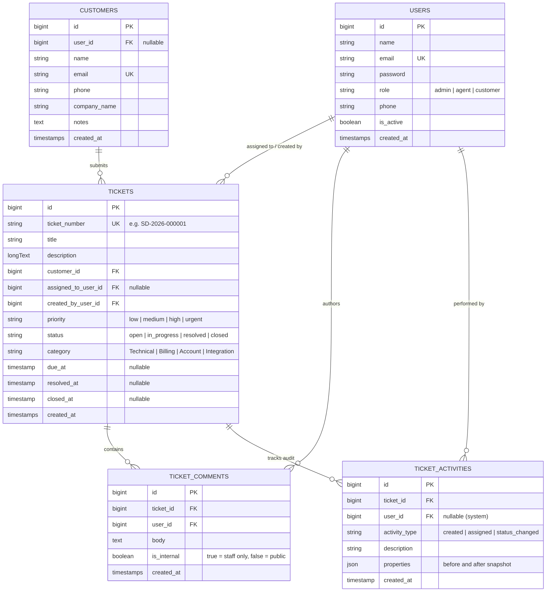

# SupportDesk CRM — Professional IT Helpdesk & Customer Support Platform

[](https://laravel.com)
[](https://php.net)
[](https://tailwindcss.com)
[](tests)
[](LICENSE)

**SupportDesk CRM** is a modern, enterprise-grade IT Helpdesk and Customer Relationship Management web application built with **Laravel 13**, **PHP 8.4**, **MySQL**, and **Tailwind CSS v4**.

Designed following strict Clean Architecture and Domain-Driven design principles, it provides organizations with end-to-end incident ticketing, SLA tracking, agent workload balancing, multi-role authorization, customer directories, and real-time operational analytics.

---

## 🌟 Key Features

### 1. Multi-Role Authentication & Access Control
- **Three Distinct Roles**:
  - **Administrator (`admin`)**: Complete system authority, team management, customer management, ticket deletion, and comprehensive reporting.
  - **Support Agent (`agent`)**: Triage unassigned queue, manage assigned tickets, post public replies & private internal staff notes, change ticket lifecycle states.
  - **Customer (`customer`)**: Self-service portal restricted exclusively to their organization's submitted tickets.
- **Server-Side Security**: Enforced via dedicated Laravel Policies (`TicketPolicy`) and route middleware (`EnsureUserRole`). Security does not rely on frontend button visibility.

### 2. Full Ticket Lifecycle Management
- **Automated Sequential Ticket IDs**: Standardized `SD-YYYY-XXXXXX` format (e.g., `SD-2026-000001`).
- **Enforced State Machine**: Validates legal status transitions (`Open` &rarr; `In Progress` &rarr; `Resolved` &rarr; `Closed`) preventing unauthorized state jumps.
- **Priority & SLA Matrix**: Dynamic target resolution calculation (Urgent: 4h, High: 24h, Medium: 48h, Low: 72h) with automated overdue alerts.
- **Categorization**: Multi-category tagging (Technical, Billing, Account, Integration, General) with search and multi-parameter filtering.

### 3. Internal Collaboration & Audit Logging
- **Public Replies vs. Internal Staff Notes**: Support agents can record private investigation notes hidden from customers.
- **Immutable Audit History**: Every state change, priority adjustment, and agent reassignment creates an immutable `ticket_activities` log preserving actor, timestamp, and before/after properties.

### 4. Interactive Operations Dashboard
- **6 Real-time KPI Cards**: Active Open Tickets, Average Resolution Time, SLA Compliance Rate (%), Overdue Tickets, Unassigned Triage Count, and Total Resolved.
- **My Queue**: Urgency-highlighted ticket queue for the currently authenticated agent.
- **Live Activity Feed**: Chronological stream of recent system and agent events.
- **Visual Analytics**: Interactive category breakdown progress meters and priority volume snapshots.

### 5. Customer Relationship Management (CRM)
- Dedicated Customer profiles linked to organizations, contact info, and lifetime support history.
- Pre-populates customer context when filing new support tickets.

---

## 📐 Database Architecture & Entity Relationships



---

## 💻 Tech Stack

- **Backend**: Laravel 13.x, PHP 8.4 (Attributes, Enum Casts, Constructor Promotion)
- **Database**: MySQL 9.x (Development & Production), In-Memory SQLite (Automated Testing)
- **Frontend**: Blade Templates, Tailwind CSS v4.0, Vite 8.0, Instrument Sans Font
- **Testing**: PHPUnit 12.x (Feature and Unit Tests with Factories)
- **Code Quality**: Laravel Pint (PSR-12 Compliance)

---

## 🚀 Getting Started

### Prerequisites
- PHP 8.4+
- Composer 2.x
- Node.js 20+ & npm
- MySQL 8.x / 9.x

### Installation

1. **Clone the repository:**
   ```bash
   git clone <repository-url>
   cd supportdesk-crm
   ```

2. **Install PHP & JavaScript dependencies:**
   ```bash
   composer install
   npm install
   ```

3. **Configure Environment:**
   ```bash
   cp .env.example .env
   php artisan key:generate
   ```
   Ensure `.env` contains your MySQL credentials:
   ```env
   DB_CONNECTION=mysql
   DB_HOST=127.0.0.1
   DB_PORT=3306
   DB_DATABASE=supportdesk_crm
   DB_USERNAME=root
   DB_PASSWORD=
   ```

4. **Run Migrations & Seed Demo Data:**
   ```bash
   php artisan migrate --seed
   ```

5. **Compile Frontend Assets:**
   ```bash
   npm run build
   ```

6. **Start the Development Server:**
   ```bash
   php artisan serve --port=8000
   ```
   Visit `http://127.0.0.1:8000` in your browser.

---

## 🔑 Demo Accounts

The database seeder provisions pre-configured accounts for testing:

| Role | Email | Password | Access Level |
| :--- | :--- | :--- | :--- |
| **Administrator** | `sarah@helpdesk.com` | `password` | Full system access, Agent management, Reports, Delete tickets |
| **Support Agent** | `alex@supportdesk.test` | `password` | Ticket queue, Triage, Customer management, Internal notes |
| **Customer** | `daniel@acme.com` | `password` | View and reply to Acme Corporation support tickets |

> [!TIP]
> The login screen includes 1-click credential selector buttons to quickly switch between personas.

---

## 🧪 Testing & Code Quality

Run the automated PHPUnit test suite:
```bash
php artisan test
```

Run Laravel Pint to format code according to PSR-12:
```bash
./vendor/bin/pint
```

---

## 🛡️ Security Features
- **SQL Injection Prevention**: Eloquent ORM parameterized queries used exclusively.
- **Cross-Site Scripting (XSS)**: Automatic Blade HTML entity escaping.
- **CSRF Protection**: Token validation on all mutating requests.
- **Strict Authorization**: Policies inspect model IDs against authenticated user records before permitting edits.
- **Secure Password Hashing**: Native `bcrypt` rounds.

---

## 📄 License
This project is open-source software licensed under the [MIT license](LICENSE).
